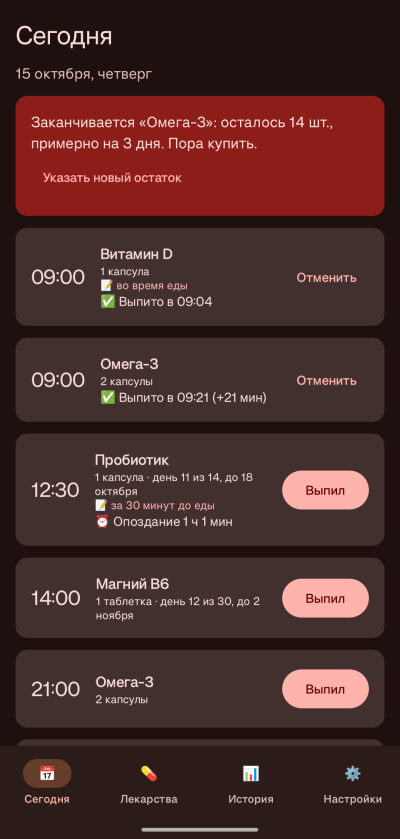
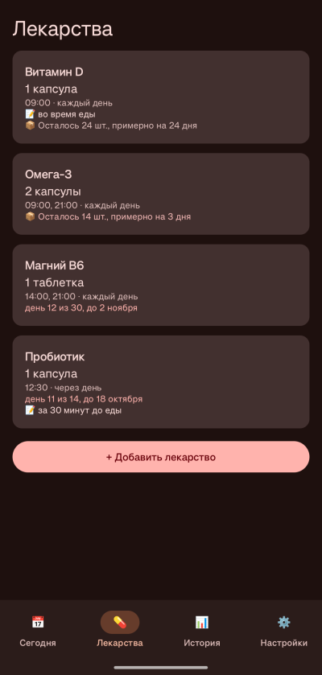
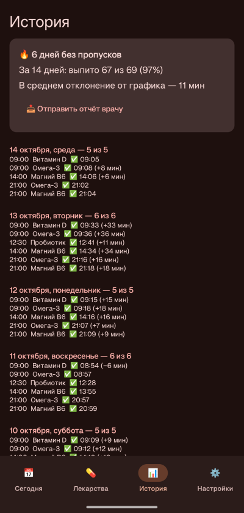
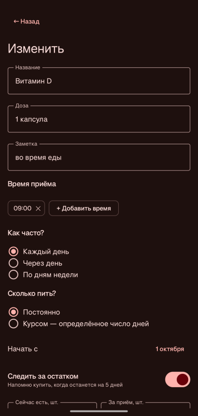
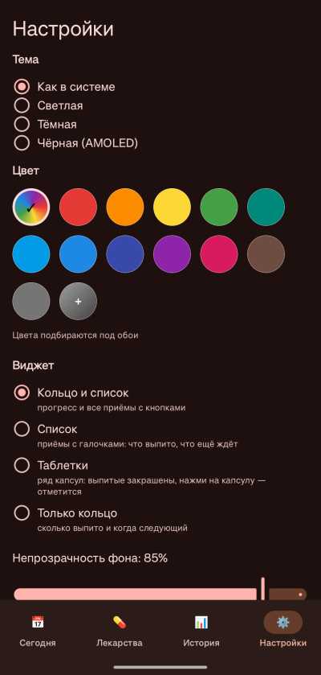
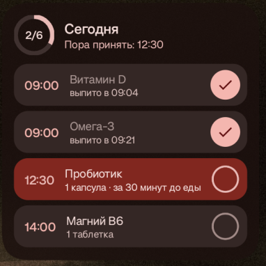
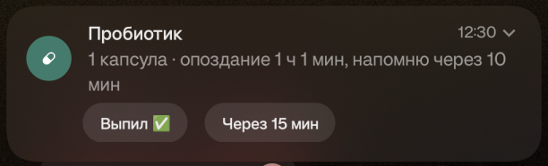
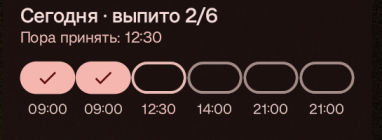

# Таблетки (pillcheck)

[English version](README.en.md)

Android-приложение, которое не даёт забыть или сдвинуть приём лекарств. Напоминает точно в срок и повторяет напоминание, пока не отметишь, что выпил.

Сделано для лекарств, где важна регулярность: пропуск или сдвиг приёма может вызвать синдром отмены.

> ⚠️ Это не медицинское изделие и не замена врачу. Схему приёма назначает врач; приложение только помогает её соблюдать.

<p>
  
  
  
</p>
<p>
  
  
  
</p>

## Скачать

Готовый APK — в разделе [Releases](../../releases/latest). Нужен Android 12 или новее.

## Что умеет

**Напоминания**
- Уведомление точно в назначенное время — даже когда телефон спит.
- Не отметил приём — напоминание повторяется каждые 10 минут, со звуком и вибрацией. Через 12 часов приём считается пропущенным.
- Кнопки прямо в уведомлении: «Выпил ✅» и «Через 15 мин».
- Несколько лекарств в одно время — общее уведомление с кнопкой «Выпил всё».
- На экране блокировки — без названий лекарств.
- Напоминания переживают перезагрузку телефона и смену часового пояса.



**Лекарства**
- Сколько угодно лекарств и приёмов в день.
- Расписание: каждый день, через день или по дням недели.
- Курс на заданное число дней — «день 5 из 14», после курса напоминания прекращаются сами.
- Заметка к приёму: «до еды», «запивать водой».
- Учёт остатка в упаковке и напоминание купить, когда остаётся на 5 дней.

**История**
- Когда выпито и на сколько сдвинулся приём от графика.
- Серия дней без пропусков и процент выполнения за месяц.
- Текстовый отчёт для врача — отправить в мессенджер или на почту.
- Резервная копия в файл и восстановление — для переезда на новый телефон.

**Внешний вид**
- Темы: как в системе, светлая, тёмная, чёрная (AMOLED).
- Цвет акцента: из обоев (Material You), 12 готовых или свой.
- Виджет на рабочий стол с четырьмя видами (кольцо и список, список, таблетки, только кольцо), меняет вид под размер; приём можно отметить прямо с виджета.
- Русский и английский язык: по языку телефона, а на Android 13+ можно выбрать отдельно для приложения.



*На скриншотах — выдуманные данные.*

## Чтобы напоминания не терялись

Android и особенно оболочки производителей усыпляют приложения в фоне. После установки:

1. На вкладке «Сегодня» нажми все красные карточки — уведомления, точные напоминания, ограничение батареи.
2. **OnePlus, Realme, OPPO:** *Настройки → Приложения → Таблетки → Использование батареи* — разрешить фоновую активность (и автозапуск, если есть). Закрепить приложение в недавних.
3. **Xiaomi:** включить автозапуск и в «Контроле активности» выбрать «Нет ограничений».
4. **Samsung:** убрать приложение из «спящих» в настройках батареи.

## Сборка

Нужны Android Studio (или JDK 21+ и Android SDK 37).

```bash
./gradlew assembleRelease
```

APK появится в `app/build/outputs/apk/release/`. Релизная сборка подписывается отладочным ключом компьютера, на котором собрана, — для установки в обход Google Play этого достаточно.

## Как устроено

Kotlin + Jetpack Compose, без сторонних библиотек кроме AndroidX.

| Файл | Что внутри |
|---|---|
| `Model.kt` | лекарства, расписание, отметки, статистика, отчёт, резервная копия |
| `Reminders.kt` | будильник и уведомления |
| `Screens.kt`, `SettingsScreen.kt` | экраны |
| `Theme.kt` | темы и палитра из одного цвета |
| `Widget.kt` | виджет |
| `res/values/strings.xml`, `res/values-ru/strings.xml` | тексты на английском и русском |

- Будильник один на всё приложение — `AlarmManager.setAlarmClock`, тот же механизм, что у «Часов». Он срабатывает точно и в глубоком сне.
- Каждое срабатывание пересчитывает всё заново из расписания и отметок (`Reminders.sync`), поэтому нет состояния, которое могло бы разойтись с реальностью.
- Данные — в `SharedPreferences`: список лекарств одной JSON-строкой и отметки о приёме. Никуда не отправляются.

## Лицензия

[MIT](LICENSE)
